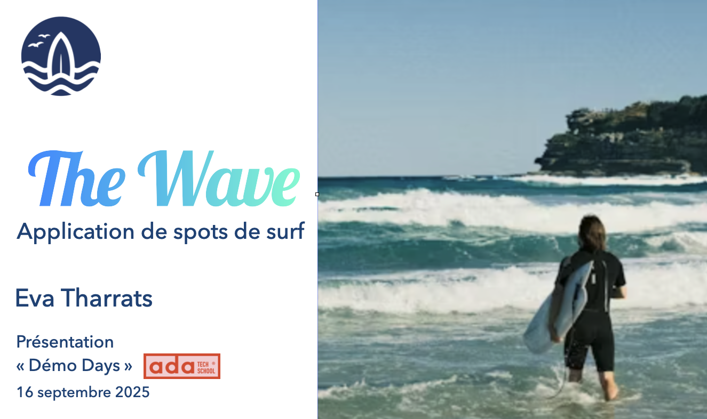

# 🌊 The Wave - application de spots de surf

Une plateforme communautaire connectant les surfeurs du monde entier autour de leur passion pour le surf.

<p align="center">

</p>

## 📋 Description

The Wave est une application web permettant aux passionnés de surf de découvrir et partager des spots de surf à travers le monde. La plateforme offre un espace de communauté où les surfeurs peuvent se connecter, explorer de nouveaux spots, liker et partager leurs expériences via des commentaires.

## 🔗 Démo

- **Site en ligne** : https://the-wave-eight.vercel.app/

## ✨ Fonctionnalités

- Carte interactive des spots de surf dans le monde
- Affichage des spots de surf en lazy loading
- Système d'authentification sécurisé
- Profil "demo" pour se connecter en lecture seule
- Panel d'administration pour les utilisateurs admin : gestion des profils utilisateurs : création, modification, suppression (visible en mode "demo" en lecture seule)
- Exploration des spots par localisation

## 🛠️ Installation

Les instructions détaillées se trouvent dans le README de chaque dossier :

- 👉 [Backend (API, base de données, seeds)](./surf-back/README.md)
- 👉 [Frontend (application Next.js)](./surf-front/README.md)

## 🚀 Technologies utilisées

### Frontend

- **Next.js** - Framework React pour le rendu côté serveur
- **React** - Librairie JavaScript pour l'interface utilisateur
- **Tailwind CSS** - Framework CSS utility-first
- **React Leaflet** - Cartes interactives

### Backend

- **Express.js** - Framework Node.js pour l'API
- **Prisma** - ORM pour la gestion de la base de données
- **PostgreSQL** - Base de données relationnelle
- **Neon** - Hébergement de la base de données PostgreSQL

### Authentification & Sécurité

- **JWT** - Gestion des tokens d'authentification
- **bcrypt** - Hashage sécurisé des mots de passe

## 🔒 Authentification

Inscription et connexion sécurisées, avec gestion des rôles (admin, modérateur, utilisateur, demo).
Le panel d'administration est accessible aux admins, et en lecture seule au compte demo.

## 🚧 Statut du projet

Ce projet est actuellement en développement. Les fonctionnalités principales implémentées incluent :

- ✅ Système d'authentification complet
- ✅ Affichage des spots de surf sur carte interactive
- ✅ Panel d'administration avec visualisation des membres
- 🚧 Fonctionnalités communautaires en cours de développement

<details>
<summary>📦 Structure du projet</summary>

```
the-wave/
    ├── surf-back/               # API Express.js
    │       ├── prisma/          # Schéma, seeds et migrations
    │       ├── middleware/      # Token, roles, password
    │       └── routes/          # Routes
    └── surf-front/              # Application Next.js
            ├── src/
            │   ├── app/         # Pages et routing Next.js
            │   └── components/  # Composants React
            │    ├── lib/        # Configuration de l'API et fonctions de fetch
            │    └── utils/      # Hooks personnalisés (useAuth, usePermissions)
            └── public/          # Assets statiques
```

</details>

## 👤 Auteur

Eva Tharrats

## 📄 Contexte du projet

Ce projet a été développé dans le cadre de ma formation à Ada Tech School - Septembre 2025.
